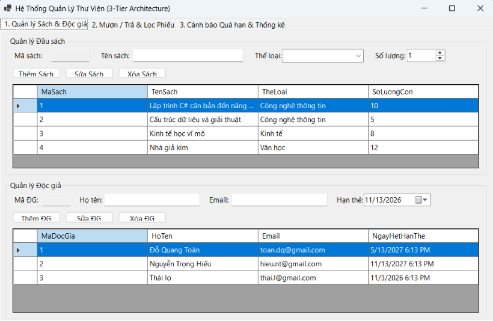
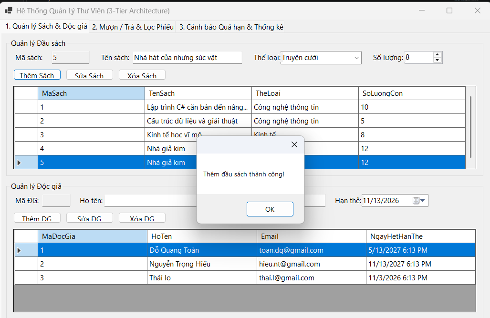
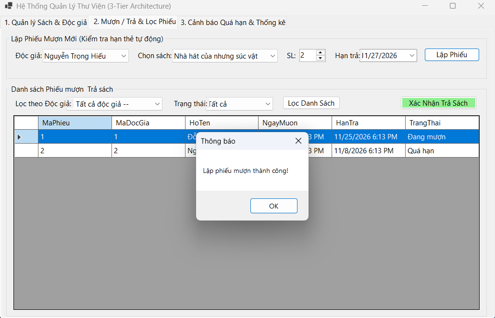
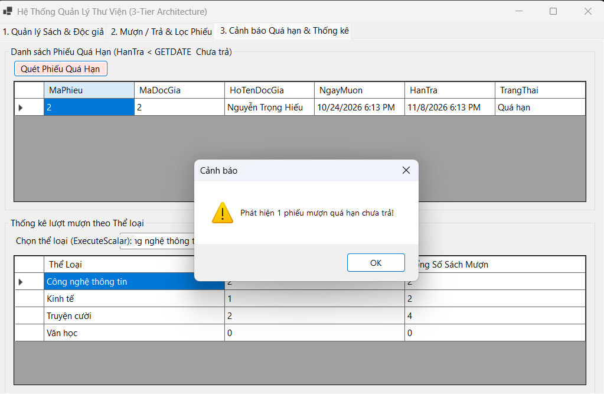
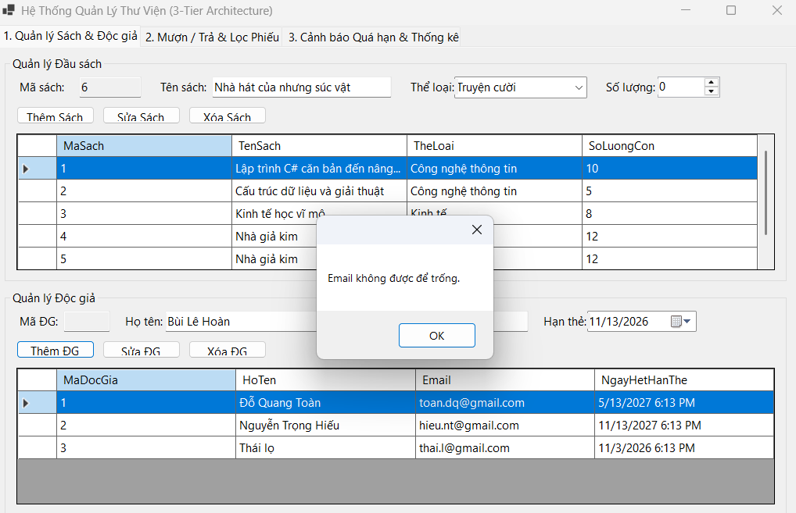

# BÁO CÁO BÀI TẬP 6.6: HỆ THỐNG QUẢN LÝ MƯỢN TRẢ SÁCH THƯ VIỆN (LIBRARY MANAGEMENT SYSTEM)

## MỤC 1: THÔNG TIN SINH VIÊN
* **Họ và tên sinh viên:** Đỗ Quang Toàn
* **Mã sinh viên:** 24810320100
* **Lớp / Khóa:** D19QTANM1

---

## MỤC 2: HÌNH ẢNH KẾT QUẢ CÁC MÀN HÌNH CHỨC NĂNG

1. **Màn hình Chính / Tổng quan hệ thống:**
   

2. **Màn hình Quản lý Danh mục (CRUD - Thêm/Sửa/Xóa):**
   

3. **Màn hình Thực thi Nghiệp vụ chính (Lập Phiếu Mượn / Trả Sách / Lọc Trạng Thái):**
   

4. **Màn hình Báo cáo - Thống kê & Cảnh báo Quá hạn:**
   

5. **Minh họa An toàn Dữ liệu (Kiểm tra ràng buộc nghiệp vụ / Phòng chống SQL Injection / Transaction Rollback):**
   
